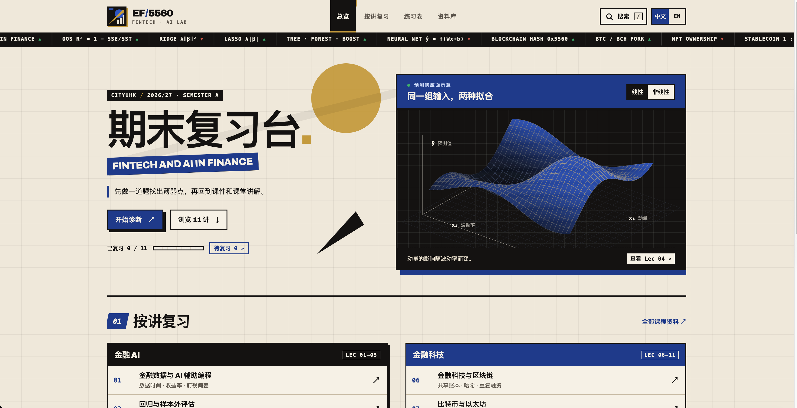
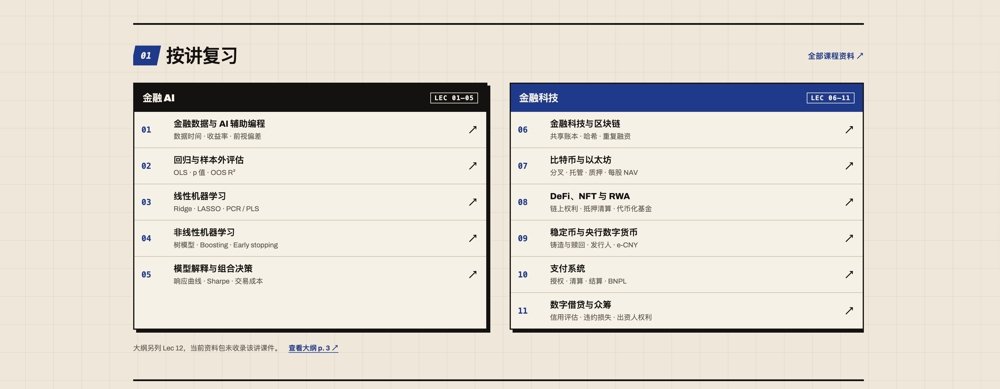
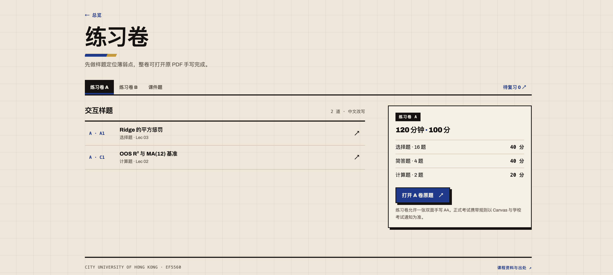
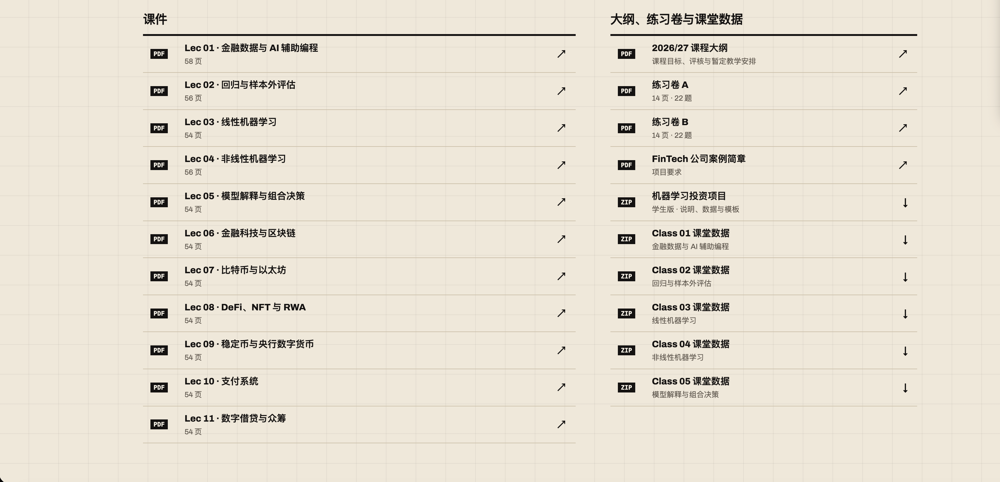

# EF5560 期末复习台


[](https://ef5560-review.vercel.app/)

给 City University of Hong Kong **EF5560 · FinTech and AI in Finance** 做的双语复习站。可以从一道诊断题开始，回到对应的讲义页，再从待复习清单重做。覆盖 2026/27 Semester A 已整理的 11 讲。

A bilingual study site for CityUHK EF5560, with lecture notes, interactive questions, and links to the original course materials.

**[打开复习网站](https://ef5560-review.vercel.app/)**

## 界面预览

### 首页与预测响应面



## 功能

- **按讲复习**分别覆盖金融 AI 和金融科技。每讲有回忆题、核心概念和讲义页码，9 份课堂转写按相关课次索引。
- **课件题库**收录 32 道选择题、10 道简答题和 2 组随堂检查。可按课次和题型筛选，答案带自编参考解析。
- **练习卷**提供 A/B 原卷和 4 道交互样题。客观题即时检查，简答题可以对照参考思路自评。
- **资料库**收录 11 讲课件、课程大纲、练习卷、项目资料和课堂数据。
- **中英文切换**覆盖题干、选项、解析和笔记，切换时保留当前作答和筛选。
- **个人进度**用浏览器的 `localStorage` 保存。每位访问者在自己的浏览器里记录已复习课次、待复习题和语言偏好。

## 更多界面预览

### 课次索引



### 练习卷



### 资料库



## 本地运行

在仓库根目录启动静态服务，然后访问 [http://127.0.0.1:5560](http://127.0.0.1:5560)。

```sh
python3 -m http.server 5560 --bind 127.0.0.1
```

网站使用 HTML、CSS 和原生 JavaScript。首页响应面由 Three.js 与 WebGL shader 绘制，预构建脚本在 `assets/`，原始课件在 `sources/`。支持通过 Vercel 的静态站点部署。

课程材料来自 EF5560 教学资料。正式考试安排以 Canvas 和学校通知为准。
